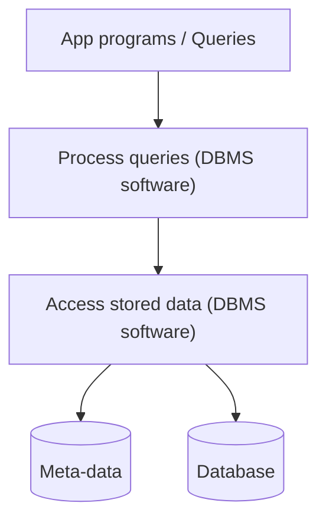
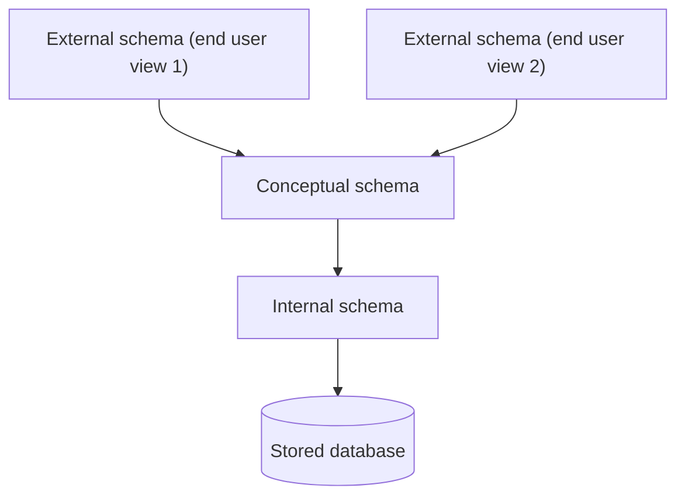
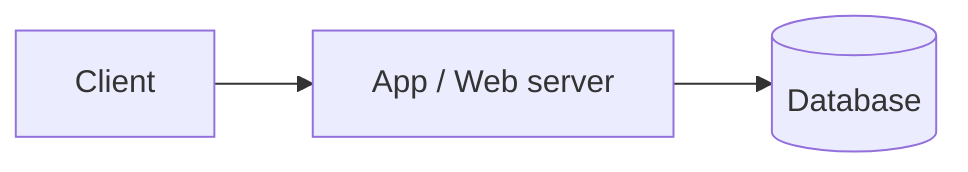

# Lecture 1: Database Concepts and DBMS Architecture

<aside>

**Legend:** 🔴 = you wrote **MCQ** next to it, 📝 = I wrote **mid-term** next to it. Exam-marked items for the course are collected on the course page.

</aside>

## Types of Databases

| # | Type | What it is used for |
| --- | --- | --- |
| 1 | **Traditional databases** | Textual and numeric data |
| 2 | **Big data systems (NoSQL)** | Manage data for social media applications; they provide cloud storage |
| 3 | **Multimedia databases** | Images, audio clips and video streams stored digitally |
| 4 | **GIS** (geographic information systems) | Store and analyze maps, weather data and satellite images |
| 5 | **Data warehouses / OLAP systems** | Companies' very large business information data |
| 6 | **Real-time / active database tools** | Industrial and manufacturing processes |

## What is a Database?

A database has three defining properties:

1. It represents a **miniworld**, also called the **universe of discourse (UoD)**. Changes in the miniworld are reflected in the database.
2. It is a **coherent collection of data** with some inherent meaning.
3. It is **designed, built and populated** with data for a **specific purpose**.

## Database Management System (DBMS)

A **DBMS** is a computerized system that enables users to **create and maintain** a database. It does four jobs:

| Function | Meaning |
| --- | --- |
| **1. Defining** | Specifying data types, structures and constraints. These definitions are stored in a dictionary called **meta-data**. |
| **2. Constructing** | Storing the data on a storage medium. |
| **3. Manipulating** | Functions performed on the database, such as querying and updating. |
| **4. Sharing** | Letting multiple users access the database. |

### Structure of a database system

A **database system** is the database plus the DBMS software and the programs that use it. Application programs and queries talk to the DBMS software, which processes the query, then accesses the stored data and the meta-data.

## Basic DBMS Modules

- **Client module:** handles user interaction and provides user-friendly interfaces.
- **Server module:** handles data storage, access, search and other functions.

## Data Abstraction and Data Models

- **Data abstraction:** suppression of details while highlighting the essential features.
- **Data model:** a set of concepts that can be used to describe the structure of a database.

## Categories of Data Models 🔴

| Category | Also called | Examples | About |
| --- | --- | --- | --- |
| **1. High-level** | Conceptual | Entity-Relationship (ER) model, object data model | Close to how end users see data |
| **2. Logical** | Representational / implementation | Relational, network, hierarchical (together: record-based data models) | Sits between the two; what DBMSs actually implement |
| **3. Low-level** | Physical | Physical models | **How data is stored**; used by specialists |
| **4. Self-describing** |  |  | The data carries its own structure description |

<aside>
💡

**Spectrum:** from the specialists' side to the end user's side the order is **low-level (physical) → implementation (logical) → high-level (conceptual)**.

</aside>

## Schema vs Database State

|  | Schema | Database state (snapshot) |
| --- | --- | --- |
| **Also called** | **Intension** | **Extension** |
| **Meaning** | The description of the database | The data in the database at a particular moment |
| **Changes** | Rarely | Every time data is inserted, updated or deleted |

A **schema diagram** shows the structure only. Example: NAME, GPA, CLASS. Each box in it (NAME, GPA, CLASS) is a **schema construct**.

## Three-Schema Architecture

| Level | Describes |
| --- | --- |
| **External schemas** | What each group of **end users** sees (their own views) |
| **Conceptual schema** | The structure of the whole database for all users |
| **Internal schema** | The physical storage of the data |

## DBMS Architectures

- **Centralized DBMS:** all DBMS functionality, program execution and the user interface were on **one machine**.
- **Basic client/server architecture:** computing environments where everything is connected to a network. It defines **specialized servers** with specific functionalities.
- **Two-tier client/server:** software components are distributed among **two systems: client and server**.
- **Three-tier and n-tier (web applications):** three-tier **adds an intermediate layer** between the client and the database server.

